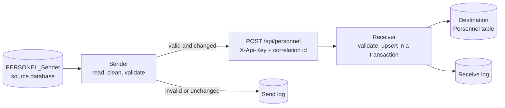

<div align="center">

# Personnel Sync (ETL)

**A safe, traceable way to move personnel records from SQL Server to a destination system over an authenticated API.**


[How it works](#how-it-works) ·
[Getting started](#getting-started) ·
[Desktop app](#the-desktop-app) ·
[Safety](#safety-measures)

</div>

---

## Overview

The system copies personnel records from a source table (`PERSONEL_Sender`) to a destination database through an
HTTP API. A record is never lost, never sent twice without a reason, and an old version never overwrites a newer one.
Every attempt, on both sides, is written to an audit log.

| Part | What it is |
|---|---|
| **Sender** | Windows desktop app (WPF). Reads the source, validates each record and sends it. |
| **Receiver** | ASP.NET Core Web API. Validates again, writes to the destination and records the result. |



## How it works

1. The Sender reads the records from `PERSONEL_Sender` and cleans them up (trims text, converts Persian digits to
   English digits).
2. Each record is validated. Invalid records are not sent. They are logged with the reason.
3. The Sender compares the record with what it sent last time. Unchanged records are skipped, new and changed
   ones go to the Receiver (`POST /api/personnel`, `X-Api-Key` header, plus a correlation id).
4. The Receiver validates the record again, then inserts or updates it inside one transaction. It answers with the
   result and the list of changed fields.
5. Both sides save the outcome, so any record can be followed from the source to the destination by its correlation id.

Possible outcomes for a record:

| Result | Meaning |
|---|---|
| Inserted | New person, added to the destination |
| Updated | Existing person, some fields changed |
| Duplicate | Nothing changed, nothing written |
| ValidationFailed | Failed the validation rules (HTTP 422) |
| RejectedNationalCodeConflict | The national code already belongs to another person (HTTP 409) |

<details>
<summary><b>Validation rules</b></summary>

- `PerId` is greater than zero.
- First name and last name are required, at most 100 characters.
- The national code must be a valid Iranian national code (10 digits and a correct check digit).
- Email, if given, must be a valid address.
- Mobile number, if given, must look like `09xxxxxxxxx`.
- Other text fields have maximum lengths (see `PersonnelFieldLimits`).

The rules live in one place (`PersonnelValidator`) and both the Sender and the Receiver use it.

</details>

## Solution structure

| Project | What it does |
|---|---|
| `WebService.Contracts` | `PersonnelRecord`, validation rules, text normalizer, national code check |
| `WebService.LogData` | EF Core model and migrations: `Personnel` (destination), `SendLogs`, `ReceiveLogs`, `SendStates` |
| `WebService.Receiver` | Web API: API key authentication, rate limiting, upsert with transaction and locking |
| `WebService.Sender.Core` | Sync engine: reading the source, deciding what to send, sending with retry, run lock, pause and resume |
| `WebService.Sender` | The desktop application |

## Getting started

You need the .NET 10 SDK and SQL Server (LocalDB is enough).

**1. Create the database and apply migrations.** The apps do not migrate by themselves, and the Receiver refuses to
start if the schema is behind.

```bash
dotnet tool install --global dotnet-ef   # once
dotnet ef database update --project WebService.LogData --startup-project WebService.LogData --connection "Server=(localdb)\MSSQLLocalDB;Database=WebServiceEtlDb;Trusted_Connection=True;TrustServerCertificate=True;"
```

**2. Create the demo source table.** Run `scripts/Seed-PersonelSender.sql` in SSMS or Visual Studio. It creates
`PERSONEL_Sender` with 200 sample people: 120 valid and 80 invalid (bad national codes, empty names, wrong emails and
mobile numbers, and so on), so the dashboard has something to show.

**3. Set the API key.** Use the same value for both apps and do not commit a real key. The simplest way is an
environment variable (PowerShell, set before starting each app):

```powershell
$env:Security__ApiKeys__SenderService = "<your key>"   # Receiver
$env:ReceiverApi__ApiKey = "<your key>"                # Sender
```

Every setting in `appsettings.json` can be overridden this way, using `__` in place of `:`.

**4. Run.**

```bash
dotnet run --project WebService.Receiver   # API, https://localhost:7098
dotnet run --project WebService.Sender     # desktop app
```

Or open `WebService.slnx` in Visual Studio and start both projects.

<details>
<summary><b>Configuration reference</b></summary>

| Setting | Where | Default in the repo |
|---|---|---|
| `ConnectionStrings:AppDatabase` | Receiver | LocalDB, `WebServiceEtlDb` |
| `Security:ApiKeys:SenderService` | Receiver | placeholder, must be changed |
| `RateLimiting:PermitLimitPerMinute` | Receiver | 6000 |
| `SourceDatabase:ConnectionString` | Sender | LocalDB, `WebServiceEtlDb` |
| `AppDatabase:ConnectionString` | Sender | LocalDB, `WebServiceEtlDb` |
| `ReceiverApi:BaseUrl` | Sender | `https://localhost:7098/` |
| `ReceiverApi:ApiKey` | Sender | placeholder, must be changed |
| `Sync:NormalizeArabicLetters` | Sender | `false` |
| `Ui:EnableToasts` | Sender | on |

</details>

## The desktop app

The interface is in Persian, right to left, and dates use the Solar Hijri calendar. It is built with WPF-UI (Fluent
design, follows the Windows light and dark theme) and LiveCharts2 for the charts.

- **Dashboard.** Start, pause, continue and stop a run. Pause waits for the current record to finish, so no request is
  cut in half, and a stopped run can be resumed later. It shows summary cards, a live throughput chart, a status chart,
  and a results table with search, status filter and CSV export. Clicking a row shows every field of the record, which
  fields changed, the server's answer and the correlation id.
- **Explorer.** Browse the source table and see which records are valid before sending anything.
- **History.** Previous runs and the result of each record.
- **Settings.** Theme, connection tests and the log folder.
- **Notifications.** A message inside the app, and a Windows notification when a run finishes or the connection is lost.

## Safety measures

- Only one run can be active at a time (run lock).
- Transient SQL and HTTP errors are retried with backoff, and circuit breakers stop the app from hammering a database or API that is down.
- The Receiver locks the row while it writes, so two requests for the same person cannot collide.
- A national code cannot belong to two people. The conflict is rejected and logged.
- API keys are compared in constant time and the API is rate limited per client.
- Spreadsheet formula injection is prevented in CSV exports.

## Tech stack

.NET 10, ASP.NET Core, Entity Framework Core, SQL Server, Dapper, Polly, Serilog, FluentValidation, WPF, WPF-UI,
CommunityToolkit.Mvvm, LiveCharts2.
